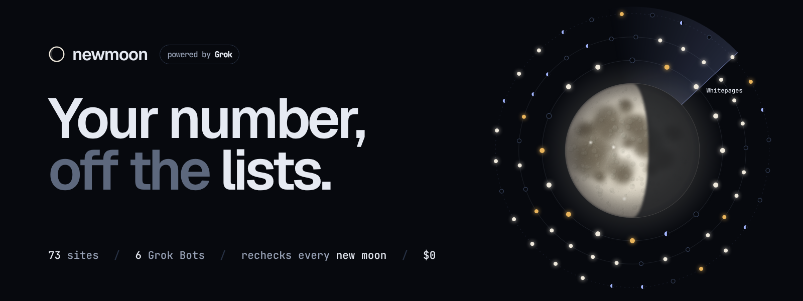
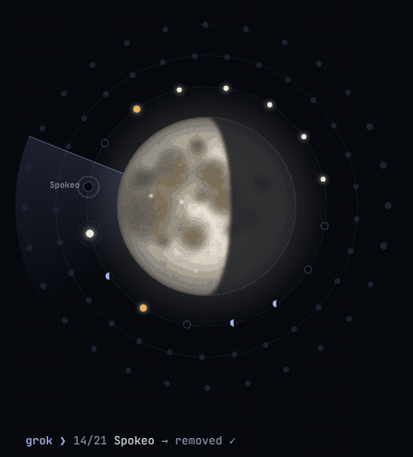
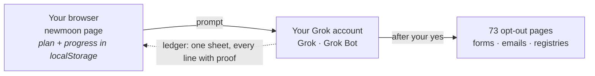
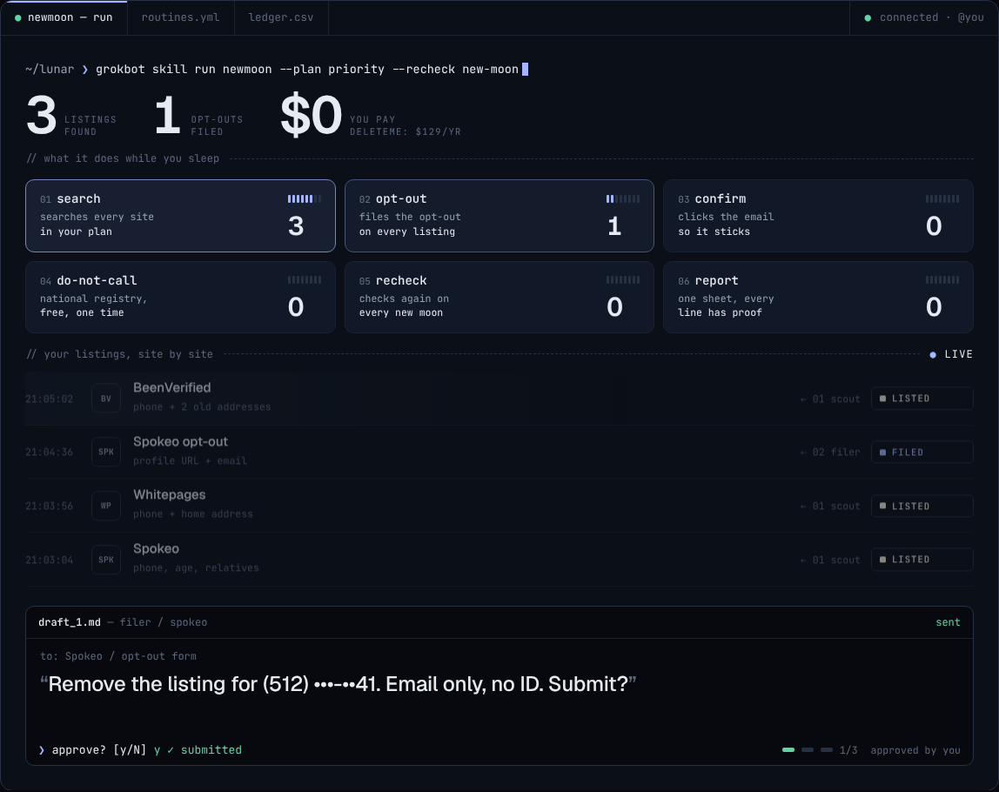
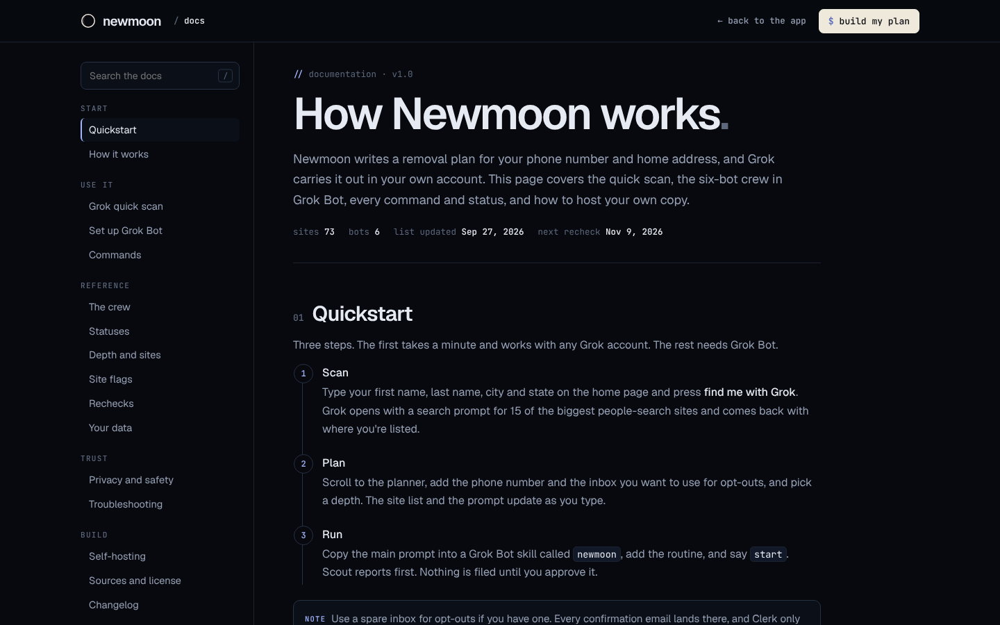

<p align="center">
  <a href="https://newmoon.tools"></a>
</p>

<p align="center">
  
  
  
  
  
</p>

<p align="center">
  <b><a href="https://newmoon.tools">Open Newmoon</a></b> &nbsp;·&nbsp;
  <a href="https://newmoon.tools/docs.html">Docs</a> &nbsp;·&nbsp;
  <a href="kit/00-main-prompt.txt">Main prompt</a> &nbsp;·&nbsp;
  <a href="#-the-sites">All 73 sites</a> &nbsp;·&nbsp;
  <a href="#-self-hosting">Self-host</a>
</p>

<br>

**Newmoon is a privacy assistant powered by Grok.** Type your name, and it builds a removal plan for your phone number and home address across 73 people-search and caller-ID sites. Then Grok does the work in your own account: a one-minute scan in Grok, or a crew of six Grok Bots that files every opt-out, clicks the confirmation emails, puts your number on Do Not Call and checks again on every new moon.

Nothing gets sent without your yes. No ID, no card, no server. DeleteMe charges $129 a year for this; Newmoon is free.

<table>
<tr>
<td width="46%" valign="top">

</td>
<td valign="top">

### 🌑 Why "new moon"

A new moon is the night you can't see the moon at all. That's the goal for your listings.

On the site, your plan is drawn as an orbit. Every site is a satellite, and Grok's beam sweeps them one by one: <code>grok ❯ 16/21 Whitepages → needs you</code>. As listings come down, satellites go dark and the moon wanes with them. Clear everything and it's a new moon.

The recheck runs on the real lunar cycle, every 29.5 days, so data brokers that buy your record back get caught on the next new moon.

</td>
</tr>
</table>

## 🌒 Quickstart

1. **Scan.** Open [Newmoon](https://newmoon.tools), type your name, city and state, press **find me with Grok**. Grok opens with a search prompt for the 15 biggest people-search sites and tells you where you're listed.
2. **Plan.** In the planner, add the phone number and a spare inbox for opt-outs, and pick a depth: 11, 16, 45 or 73 sites.
3. **Run.** Paste the main prompt into a Grok Bot skill called `newmoon`, add [`routines.yml`](kit/routines.yml), say `start`.

> [!TIP]
> No Grok Bot yet? The prompts work as plain files too: [`kit/00-main-prompt.txt`](kit/00-main-prompt.txt) has a fill-in-the-blanks version with every site in priority order.

## 🌓 How it works



Newmoon is one static page. It builds text: a plan and a set of prompts. Grok does the searching, filling and clicking, inside your account. Newmoon has no backend, so it can't see your data, and it can't look anyone up by itself.

<p align="center">
  
</p>

## 🌔 The crew

| | Bot | Job | Never |
|---|---|---|---|
| `01` | **Scout** | Searches each plan site by name + city, phone and address. Saves the listing URL and a screenshot. | searches for anyone but you |
| `02` | **Filer** | Fills each site's own opt-out form with only what the listing already shows. Drafts first, number masked. | submits without your yes |
| `03` | **Clerk** | Opens confirmation emails from plan sites and clicks the link after you approve. | opens any other email |
| `04` | **Registry** | Do Not Call, Google "Results about you", OptOutPrescreen, California DROP. | hands over an SSN, ID or card |
| `05` | **Watch** | Searches every cleared site again on each new moon. Reopens anything that came back. | re-files without asking |
| `06` | **Ledger** | One table: site, status, listing URL, dates, proof. Sent after every run. | marks removed without proof |

<details>
<summary><b>Commands you can type to your bot</b></summary>
<br>

| You say | What happens |
|---|---|
| `start` | Registry runs, then Scout searches the first five sites and reports |
| `status` | One line per bot: what it's doing, what's waiting on you |
| `what needs me` | Every NEEDS YOU item, with the exact link and step |
| `yes` / `no` | Approve or reject the draft on screen |
| `yes to all Spokeo` | Approve every draft for one site |
| `skip MyLife` | Mark it skipped and move on |
| `ledger` | Send the table now |
| `watch now` | Recheck today instead of waiting for the new moon |
| `pause` / `resume` | Stop every bot, or carry on |

</details>

## 🌕 The sites

45 sites come from [BADBOOL](https://github.com/yaelwrites/Big-Ass-Data-Broker-Opt-Out-List), the volunteer opt-out list Yael Grauer has kept up since 2017 (updated Sep 27, 2026). 28 more are Newmoon additions: caller-ID apps like Truecaller and Sync.me, the Dataveria network, ClustrMaps, PeekYou, Pipl, LexisNexis and others.

| Depth | Sites | What's in it |
|---|---:|---|
| Crucial | 11 | what BADBOOL marks crucial |
| Priority | 16 | crucial + high priority |
| Full BADBOOL | 45 | the whole BADBOOL list |
| Max | 73 | plus caller-ID apps and Newmoon additions |

<details>
<summary><b>All 73 sites with direct opt-out links</b></summary>
<br>

| # | Site | Tier | Needs | Links |
|---:|---|---|---|---|
| 1 | BeenVerified<br><sub>also PeopleLooker, PeopleSmart</sub> | crucial | email link |  [opt out](https://www.beenverified.com/app/optout/search) |
| 2 | CheckPeople | crucial | birthdate | [find](https://checkpeople.com/privacy-rights) [opt out](https://checkpeople.com/opt-out) |
| 3 | Clustal | crucial | listing url, email link | [find](https://www.clustal.org) [opt out](https://www.clustal.org/privacy-control) |
| 4 | Intelius<br><sub>also Instant Checkmate, TruthFinder, Classmates, AnyWho, ZabaSearch, US Search, PeopleFinder, Addresses.com</sub> | crucial | email link | [find](https://www.intelius.com/) [opt out](https://suppression.peopleconnect.us/login) |
| 5 | Men Stopping Violence | crucial | listing url, email link | [find](https://www.menstoppingviolence.org/people/) [opt out](https://www.menstoppingviolence.org/opt-out/) |
| 6 | MyLife | crucial | 📞 phone call | [find](https://www.mylife.com) [opt out](https://www.mylife.com/privacyrequest) |
| 7 | Nuwber | crucial | listing url, email link | [find](https://nuwber.com/) [opt out](https://nuwber.com/removal/link) |
| 8 | SmartBackgroundChecks<br><sub>also PeopleFinders</sub> | crucial | — | [find](https://www.smartbackgroundchecks.com/) [opt out](https://www.smartbackgroundchecks.com/optout) |
| 9 | Spokeo | crucial | listing url, email link | [find](https://www.spokeo.com/search) [opt out](https://www.spokeo.com/optout) |
| 10 | That’s Them | crucial | — | [find](https://thatsthem.com/) [opt out](https://thatsthem.com/optout) |
| 11 | Whitepages<br><sub>also 411.com</sub> | crucial | 📞 phone call | [find](https://www.whitepages.com/) [opt out](https://www.whitepages.com/suppression_requests) |
| 12 | Acxiom | high | — |  [opt out](https://www.acxiom.com/optout/) |
| 13 | Ancestry | high | free account | [find](https://www.ancestry.com/account/) [opt out](https://support.ancestry.com/s/reportissue?language=en_US) |
| 14 | FamilyTreeNow | high | — |  [opt out](https://www.familytreenow.com/optout) |
| 15 | FastPeopleSearch | high | captcha | [find](https://www.fastpeoplesearch.com/) [opt out](https://www.fastpeoplesearch.com/optout) |
| 16 | USPhoneBook | high | — | [find](https://www.usphonebook.com/) [opt out](https://www.usphonebook.com/opt-out/) |
| 17 | Archives | more | 💳 card | [find](https://www.archives.com/) [opt out](https://www.archives.com/Optout) |
| 18 | Classmates | more | free account | [find](https://www.classmates.com/) [opt out](https://help.classmates.com/hc/en-us/articles/115002224171-How-can-I-cancel-my-membership-) |
| 19 | Cyber Background Checks | more | — | [find](https://www.cyberbackgroundchecks.com/) [opt out](https://www.cyberbackgroundchecks.com/removal) |
| 20 | EveryJoe | more | listing url | [find](https://www.everyjoe.com/) [opt out](https://www.everyjoe.com/do-not-sell/) |
| 21 | Facecheck | more | 🪪 photo id | [find](https://facecheck.id) [opt out](https://facecheck.id/Face-Search/RemoveMyPhotos) |
| 22 | FamilySearch | more | free account, listing url, email link | [find](https://www.familysearch.org/search/) [opt out](https://submit-irm.trustarc.com/services/validation/b8d6e704-e5b1-42a0-9f86-bbdec35939a1) |
| 23 | FreePeopleDirectory | more | listing url | [find](https://www.freepeopledirectory.com) [opt out](https://www.spokeo.com/optout) |
| 24 | InfoTracer | more | — | [find](https://www.infotracer.com) [opt out](https://infotracer.com/optout/) |
| 25 | National Public Data | more | listing url, email link | [find](https://nationalpublicdata.com/search) [opt out](https://nationalpublicdata.com/optout.html) |
| 26 | PeopleByName | more | — | [find](https://www.peoplebyname.com/people) [opt out](https://www.peoplebyname.com/remove.php) |
| 27 | PeopleSearchNow | more | — | [find](https://www.peoplesearchnow.com/) [opt out](https://www.peoplesearchnow.com/opt-out) |
| 28 | PimEyes | more | 🪪 photo id | [find](https://pimeyes.com/) [opt out](https://pimeyes.com/en/opt-out-request-form) |
| 29 | PrivateEye | more | email link | [find](https://www.privateeye.com/) [opt out](https://www.privateeye.com/removal) |
| 30 | PrivateRecords | more | — | [find](https://www.privaterecords.net/name/landing) [opt out](https://www.privaterecords.net/api/helper/optOutLight/search) |
| 31 | PropertyRecs | more | — |  [opt out](https://dashboard.propertyrecs.com/opt-out) |
| 32 | Searchbug | more | 💳 card | [find](https://www.searchbug.com/) [opt out](https://www.searchbug.com/contact-us.aspx) |
| 33 | SearchPeopleFree | more | — | [find](https://www.searchpeoplefree.com/) [opt out](https://www.searchpeoplefree.com/opt-out) |
| 34 | SearchQuarry | more | email link | [find](https://www.searchquarry.com/) [opt out](https://members.searchquarry.com/removeMyData/) |
| 35 | Social Catfish | more | listing url, email link | [find](https://socialcatfish.com) [opt out](https://socialcatfish.com/opt-out/) |
| 36 | SpyFly | more | — | [find](https://www.spyfly.com) [opt out](https://www.spyfly.com/help-center/privacy-requests) |
| 37 | TruePeopleSearch.com | more | captcha |  [opt out](https://www.truepeoplesearch.com/removal) |
| 38 | TruePeopleSearch.net | more | listing url | [find](https://truepeoplesearch.net) [opt out](https://docs.google.com/forms/d/e/1FAIpQLSeCPggzv4iXE20iUjcr6vdVWxBOblCyGwDLcO-jZA5j2YF5fQ/viewform) |
| 39 | UN Public Administration Network | more | listing url, email link | [find](https://unpan.org/) [opt out](https://unpan.org/opt-out) |
| 40 | United States Phone Book | more | — | [find](https://www.unitedstatesphonebook.com/search.php) [opt out](https://www.unitedstatesphonebook.com/contact.php) |
| 41 | UnMask | more | email link, captcha | [find](https://unmask.com/) [opt out](https://unmask.com/opt-out/) |
| 42 | USA People Search | more | — | [find](https://www.usa-people-search.com/) [opt out](https://www.usa-people-search.com/removal) |
| 43 | Veripages | more | listing url, email link, captcha | [find](https://veripages.com/) [opt out](https://veripages.com/inner/control-privacy) |
| 44 | VoterRecords | more | email link |  [opt out](https://voterrecords.com/) |
| 45 | ZoomInfo | more | email link |  [opt out](https://privacyrequest.zoominfo.com/remove/verify) |
| 46 | PeekYou | added | listing url, email link, check link | [find](https://www.peekyou.com/) [opt out](https://www.peekyou.com/about/contact/optout/) |
| 47 | Pipl | added | email link, check link | [find](https://pipl.com/) [opt out](https://pipl.com/personal-information-removal-request) |
| 48 | PeopleFinders | added | check link | [find](https://www.peoplefinders.com/) [opt out](https://www.peoplefinders.com/opt-out) |
| 49 | ClustrMaps | added | listing url, check link | [find](https://clustrmaps.com/) [opt out](https://clustrmaps.com/bl/opt-out) |
| 50 | Neighbor.report | added | listing url, check link | [find](https://neighbor.report/) [opt out](https://neighbor.report/remove) |
| 51 | FastBackgroundCheck | added | captcha, check link | [find](https://www.fastbackgroundcheck.com/) [opt out](https://www.fastbackgroundcheck.com/opt-out) |
| 52 | IDCrawl | added | listing url, email link, check link | [find](https://www.idcrawl.com/) [opt out](https://www.idcrawl.com/opt-out) |
| 53 | PeopleWhiz | added | email link, check link | [find](https://www.peoplewhiz.com/) [opt out](https://www.peoplewhiz.com/optout) |
| 54 | CocoFinder | added | listing url, email link, check link | [find](https://cocofinder.com/) [opt out](https://cocofinder.com/remove-my-info) |
| 55 | Kiwi Searches | added | check link | [find](https://www.kiwisearches.com/) [opt out](https://www.kiwisearches.com/optout) |
| 56 | Persopo | added | listing url, email link, check link | [find](https://persopo.com/) [opt out](https://persopo.com/opt-out) |
| 57 | OfficialUSA | added | listing url, check link | [find](https://www.officialusa.com/) [opt out](https://www.officialusa.com/opt-out/) |
| 58 | LocateFamily | added | listing url, check link | [find](https://www.locatefamily.com/) [opt out](https://www.locatefamily.com/removal.html) |
| 59 | PublicDataUSA | added | listing url, check link | [find](https://www.publicdatausa.com/) [opt out](https://www.publicdatausa.com/remove.php) |
| 60 | USA-Official | added | listing url, check link | [find](https://www.usa-official.com/) [opt out](https://www.usa-official.com/remove) |
| 61 | PublicRecordsNow | added | check link | [find](https://www.publicrecordsnow.com/) [opt out](https://www.publicrecordsnow.com/static/view/optout) |
| 62 | Dataveria | added | listing url, email link, check link | [find](https://dataveria.com/) [opt out](https://dataveria.com/ng/control/privacy) |
| 63 | Verecor | added | listing url, email link, check link | [find](https://verecor.com/) [opt out](https://verecor.com/ng/control/privacy) |
| 64 | Virtory | added | listing url, email link, check link | [find](https://virtory.com/) [opt out](https://virtory.com/ng/control/privacy) |
| 65 | Vericora | added | listing url, email link, check link | [find](https://vericora.com/) [opt out](https://vericora.com/ng/control/privacy) |
| 66 | NeighborWho | added | email link, check link | [find](https://www.neighborwho.com/) [opt out](https://www.neighborwho.com/app/optout/search) |
| 67 | Ownerly | added | email link, check link | [find](https://www.ownerly.com/) [opt out](https://www.ownerly.com/app/optout/search) |
| 68 | Truecaller | caller id | captcha, check link | [find](https://www.truecaller.com/) [opt out](https://www.truecaller.com/unlisting) |
| 69 | Sync.me | caller id | captcha, check link | [find](https://sync.me/) [opt out](https://sync.me/optout) |
| 70 | NumLookup | caller id | check link | [find](https://www.numlookup.com/) [opt out](https://www.numlookup.com/opt-out) |
| 71 | Spytox | caller id | email link, check link | [find](https://www.spytox.com/) [opt out](https://www.spytox.com/opt-out) |
| 72 | LexisNexis | added | 🪪 photo id, check link | [find](https://consumer.risk.lexisnexis.com/) [opt out](https://optout.lexisnexis.com/) |
| 73 | Epsilon | added | email link, check link |  [opt out](https://www.epsilon.com/us/consumer-preference-center) |

**Registries** (every plan)

| Registry | What it does | |
|---|---|---|
| National Do Not Call Registry | Free, one time. Click the confirmation email within 72 hours. | [open](https://www.donotcall.gov/) |
| Google “Results about you” | Ask Google to drop search results that show your phone or address. | [open](https://support.google.com/websearch/answer/12719076) |
| California DROP portal | California residents: one request to 500+ registered data brokers. | [open](http://consumer.drop.privacy.ca.gov) |
| OptOutPrescreen | Stops prescreened credit and insurance offers. The 5-year electronic opt-out is free. Skip any field asking for an SSN. | [open](https://www.optoutprescreen.com/) |

</details>

> [!NOTE]
> Sites marked **check link** are Newmoon additions. Opt-out pages move, so the prompts tell your bot to open each link first and find the site's own opt-out if it changed. Spotted a dead link? [Open an issue](../../issues/new?template=broken-link.yml).

> [!IMPORTANT]
> Some steps need a human: verification calls (Whitepages, MyLife), ID or face uploads (PimEyes, Facecheck) and card-first searches (Archives, Searchbug). Your bot marks them **needs you** and tells you exactly what to do.

## 🌖 Rechecks

Watch runs on each new moon. The next twelve, computed with Jean Meeus' lunar phase formulas:

Nov 9, 2026 · Dec 9, 2026 · Jan 7, 2027 · Feb 6, 2027 · Mar 8, 2027 · Apr 6, 2027 · May 6, 2027 · Jun 4, 2027 · Jul 4, 2027 · Aug 2, 2027 · Aug 31, 2027 · Sep 30, 2027

The planner's **recheck dates .ics** button puts them in your calendar.

## 🌗 Privacy

- **Only you.** Every prompt limits the bots to the person in ABOUT ME. They ask before touching a relative's listing.
- **Nothing without a yes.** No form, email or confirmation link goes out until you approve it.
- **Nothing new.** A site only gets details its listing already shows. Your number appears masked in chat.
- **Nothing stored by us.** Your plan lives in your browser's `localStorage`. There is no server to send it to.

> [!CAUTION]
> Newmoon is for removing your own data. Don't use it to look up other people. If you're dealing with stalking or domestic violence, look up your state's address confidentiality program.

## 🌘 Self-hosting

```bash
git clone <this repo> && cd newmoon
python3 build.py https://yourdomain.com   # src/ → site/, sets link-preview URLs
npx vercel deploy site --prod             # or drag site/ onto app.netlify.com/drop
```

Or import the repo in Vercel or Netlify: `vercel.json` and `netlify.toml` already point them at `site/`, so every push redeploys.

| Setting | Where | What it does |
|---|---|---|
| `GROK_BOT_SHARE` | `src/page.html` | Your x.ai share link for the Newmoon bot. Shows a one-click "add to my Grok Bot" button. |
| `SITE_URL` | `src/page.html` | Used in prompts and share posts. Picks up your real domain automatically. |

<details>
<summary><b>Project structure</b></summary>
<br>

```
site/        what you deploy: index.html, docs.html, favicon.svg, og.png
src/         page.html (app) and docs.html (docs), the files you edit
kit/         main prompt, six bot prompts, routines.yml, brokers.json, newmoon-kit.md
motion/      launch video (newmoon-launch.mp4) and its frame renderer
assets/      README images, social preview, X header, the NEWMOON mascot
tools/       make_readme.py regenerates this file from kit/brokers.json
build.py     src → site
```

</details>

<p align="center">
  
</p>

## Credits

- Site list adapted from **[BADBOOL](https://github.com/yaelwrites/Big-Ass-Data-Broker-Opt-Out-List)** by Yael Grauer, CC BY-NC-SA 4.0. If it helps you, [buy her a coffee](https://ko-fi.com/kofisupporter11745).
- Built on **Grok** and **Grok Bot** by xAI. Newmoon is independent and not affiliated with or endorsed by xAI.
- Made by [@lunarresearcher](https://x.com/lunarresearcher).

## License

[CC BY-NC-SA 4.0](LICENSE). Keep the credit, keep it non-commercial, share changes under the same license.

<p align="center"><sub>🌑 &nbsp;your number, off the lists</sub></p>
